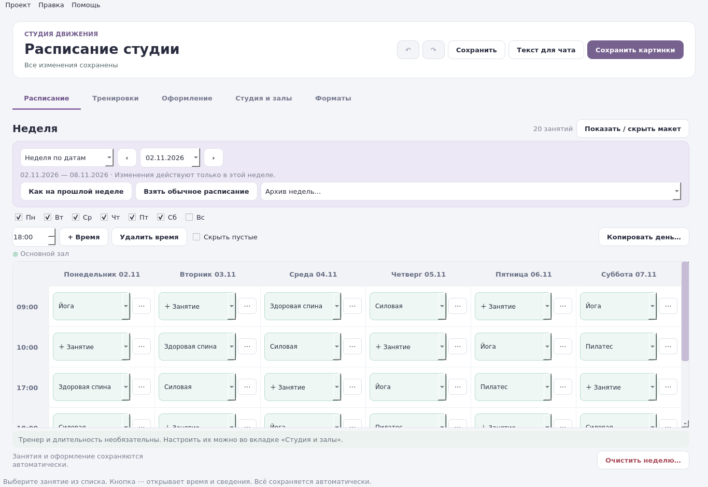

# Студия расписаний

Настольная программа для небольшой фитнес-студии: составьте обычную неделю,
внесите разовые изменения и подготовьте расписание для клиентов.
Работает локально, без регистрации.



- **Шаблон и недели по датам.** Переносы и отмены действуют только в выбранной неделе.
- **Копирование и архив.** Возьмите прошлую неделю или обычное расписание; вернитесь к прежним датам.
- **Необязательные поля.** Тренер и длительность выключены по умолчанию. Их можно учитывать только для себя или показывать клиентам.
- **Проверка пересечений.** Подсказки о занятости зала и тренера; для полной проверки нужны длительности занятий.
- **Публикация.** Картинки для соцсетей и печати, текст для чата и сообщения о переносах.
- **Свой стиль.** Название студии, залы, цвета, логотип, фон и размеры картинок.
- **Надёжное сохранение.** Автосохранение, резервная запись, отмена действий и копия проекта в JSON.

## Запуск на Windows

1. Скачайте исходники через **Code → Download ZIP** и распакуйте архив.
2. Установите Python 3.10 или новее (рекомендуется 3.12), включив **Add Python to PATH**.
3. Откройте `launch.bat`. При первом запуске зависимости установятся автоматически — нужен интернет.

Для сборки самостоятельного EXE запустите `build.bat` на Windows.
В репозитории есть workflow **Windows application** для тестирования и сборки через GitHub Actions.
Старый файл `dist/BoginiSchedule.exe` из исходного архива не является новой сборкой.

## Первые пять минут

1. **Студия и залы:** задайте название, зал и его цвет.
2. **Оформление:** добавьте контакты и логотип.
3. **Расписание → Обычное расписание:** выберите занятия в ячейках. Новое название можно добавить прямо из списка.
4. **Неделя по датам:** выберите дату; кнопка **⋯** меняет занятие, время или отменяет его только в этой неделе.
5. **Сохранить картинки** и **Текст для чата:** подготовьте публикацию.

Кнопка **Показать / скрыть макет** освобождает место для редактора на небольшом экране.
Изменения сохраняются автоматически; `Ctrl+Z` отменяет действие.

## Совместимость

Старые проекты читаются автоматически. Новая версия сохраняет схему данных 4:
для дальнейшей работы с таким проектом нужна версия 3.0 программы.
Перед обновлением сохраните отдельную копию проекта. Логотипы и фоны хранятся
по путям: при переносе проекта перенесите также исходные картинки.

[Полная инструкция](README.txt) · [Окно занятия](examples/studio/session.png) · [Предпросмотр](examples/studio/preview.png)

## Разработка

```sh
python3 -m venv .venv
.venv/bin/python -m pip install -r requirements.txt
.venv/bin/python main.py
QT_QPA_PLATFORM=offscreen .venv/bin/python -m unittest discover -s tests -v
```

На Windows используйте `.venv\Scripts\python.exe`. Windows EXE собирается на Windows.
