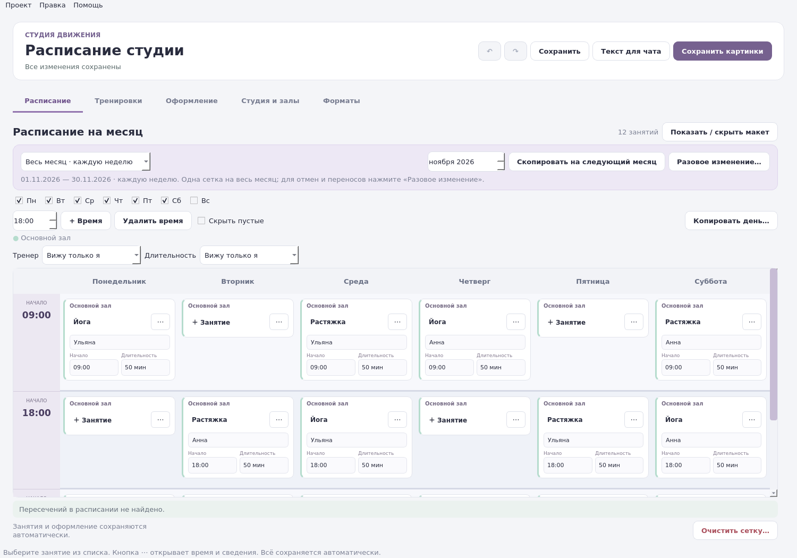

# Студия расписаний

Настольная программа для небольшой фитнес-студии: составьте обычную неделю,
внесите разовые изменения и подготовьте расписание для клиентов.
Работает локально, без регистрации.



- **Расписание на месяц.** Одна сетка повторяется каждую неделю выбранного месяца. Можно скопировать её на следующий месяц.
- **Разовые изменения.** Отдельная неделя для отмен и переносов — основное расписание месяца сохраняется.
- **Копирование и архив.** Возьмите прошлую неделю или обычное расписание; вернитесь к прежним датам.
- **Всё в ячейке.** Начало, тренер и длительность редактируются прямо в таблице. Поля можно скрыть, оставить только в редакторе или публиковать. На картинке тренер и длительность идут отдельными строками меньшим шрифтом.
- **Проверка пересечений.** Подсказки о занятости зала и тренера; для полной проверки нужны длительности занятий.
- **Публикация.** Картинки для соцсетей и печати, текст для чата и сообщения о переносах.
- **Читаемый текст поверх фото.** В светлой и тёмной темах под текстом шапки и подписей используется мягкое осветление фона без жёстких плашек.
- **Свой стиль.** Название студии, залы, цвета, логотип, фон и размеры картинок.
- **Надёжное сохранение.** Автосохранение, резервная запись, отмена действий и копия проекта в JSON.

## Версия 3.2

- Лёгкая шапка с мягким осветлением фотографии под текстом, без чёрной плашки и служебных надписей.
- Отдельные карточки залов. В пустых ячейках нет лишних полей.
- Чёткие временные полосы: время начала закреплено сверху, строки разделены линиями.
- Перенос занятия применяется после завершения ввода; редактор прокручивается к новому времени.
- Исправлено появление кратковременных отдельных окон полей при обновлении таблицы.

[Редактор с двумя залами](examples/studio/two-halls-editor.png) · [Пример экспорта с логотипом](examples/studio/bogini-a4.png)

## Запуск на Windows

1. Скачайте исходники через **Code → Download ZIP** и распакуйте архив.
2. Установите Python 3.10 или новее (рекомендуется 3.12), включив **Add Python to PATH**.
3. Откройте `launch.bat`. При первом запуске зависимости установятся автоматически — нужен интернет.

Для сборки самостоятельного EXE запустите `build.bat` на Windows.
В репозитории есть workflow **Windows application** для тестирования и сборки через GitHub Actions.
Готовый EXE собирается workflow **Windows application**; исходники запускаются через `launch.bat`.

## Первые пять минут

1. **Студия и залы:** задайте название, зал и его цвет.
2. **Оформление:** добавьте контакты и логотип.
3. **Весь месяц · каждую неделю:** выберите месяц и заполните сетку один раз. Начало, имя тренера и длительность меняйте прямо в ячейках; видимость полей выбирается над таблицей.
4. **Разовое изменение:** выберите дату, затем перенесите или отмените занятие в открывшейся неделе. Для следующего месяца нажмите **Скопировать на следующий месяц**.
5. **Сохранить картинки** и **Текст для чата:** подготовьте публикацию.

Кнопка **Показать / скрыть макет** освобождает место для редактора на небольшом экране.
Изменения сохраняются автоматически; `Ctrl+Z` отменяет действие.

## Совместимость

Старые проекты читаются автоматически. Новая версия сохраняет схему данных 5:
для дальнейшей работы с таким проектом нужна версия 3.1 или новее.
Перед обновлением сохраните отдельную копию проекта. Логотипы и фоны хранятся
по путям: при переносе проекта перенесите также исходные картинки.

[Пример тёмного экспорта](examples/studio/dark-month.png) · [Полная инструкция](README.txt) · [Окно занятия](examples/studio/session.png) · [Предпросмотр](examples/studio/preview.png)

## Разработка

```sh
python3 -m venv .venv
.venv/bin/python -m pip install -r requirements.txt
.venv/bin/python main.py
QT_QPA_PLATFORM=offscreen .venv/bin/python -m unittest discover -s tests -v
```

На Windows используйте `.venv\Scripts\python.exe`. Windows EXE собирается на Windows.
